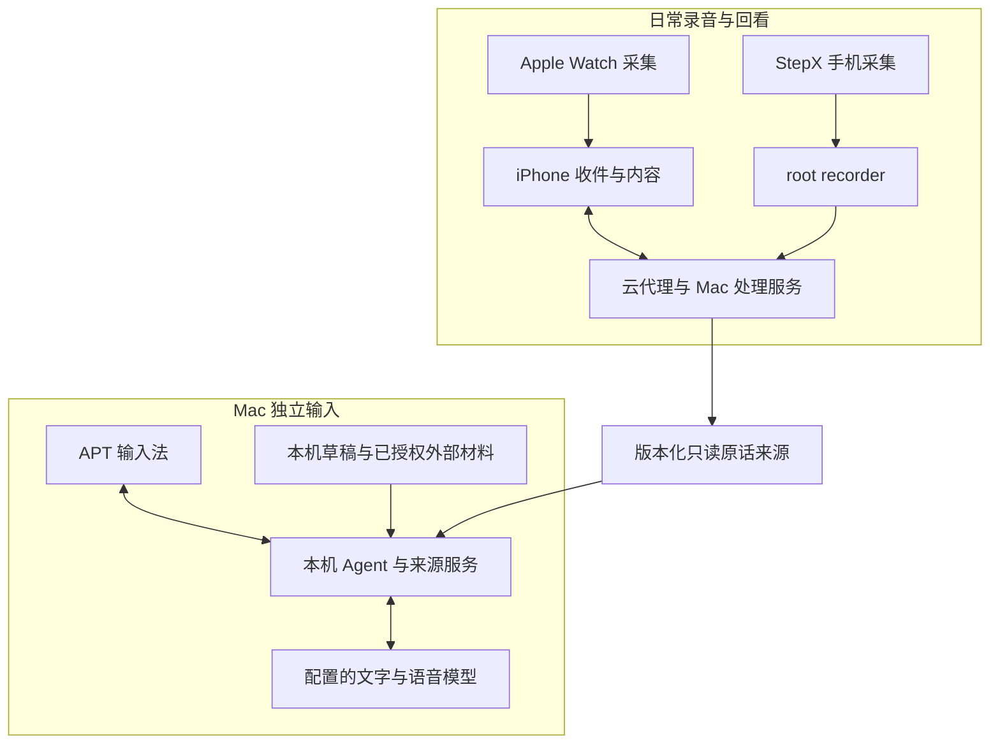

<p align="center"></p>

<h1 align="center">APT</h1>

<p align="center"><strong>把经历接成记忆，让记忆帮你行动与表达。</strong></p>

<p align="center">Mac 输入法 · iPhone / Apple Watch · StepX</p>

<p align="center">
  <a href="#快速开始">快速开始</a> ·
  <a href="docs/MacBook-input-method.md">Mac 安装与配置</a> ·
  <a href="docs/Technical-notes.md">技术与边界</a> ·
  <a href="docs/Privacy-and-data.md">隐私与数据</a> ·
  <a href="docs/作品说明.md">作品说明</a>
</p>

APT 是一个带着个人上下文的中文输入法，也连着手机上的事件、原话和行动。在 Mac 上打字、口述或写回复时，它从你授权保存的材料里找依据，给出可以修改后再填入的正文。手机端把每天发生的事整理成能回看原话的记录。

Mac 输入法可以单独使用，不需要手机或手表。

本仓库是黑客松提交用的公开源码快照（私有主线基线 `d5d3729`），不含个人数据、服务凭据或生产安装包。

## 一个例子：回复维修师傅

相机送修过一次，现在要回复师傅，却记不清上次检查到哪一步。

| 这一步 | 虚构示例 |
|---|---|
| 之前写下 | 换过镜头，异常仍存在；防抖有没有问题还没确认。 |
| 现在在输入框写 | 帮我回一下师傅，上次检查到哪一步了？ |
| 按 **⌃⇧M** | APT 查找相关草稿和原话，给出候选回复，并列出依据 |
| 核对后按 Tab | 候选填进当前输入框；改不改、发不发，由你决定 |

材料不够时，候选会保留「还没确认」，不会替你补成事实；草稿、粘贴和生成内容也不能证明你说过或发过。


*虚构资料的原生界面预览（0.16.7 / 52）；历史示例，不代表本快照 0.17.16 / 76 的界面、安装或模型实录。真实 demo 待录制。*

## 快速开始

### Mac 输入法

前提：**Apple Silicon Mac、macOS 13+、Xcode Command Line Tools、Python 3、Node.js 24+**。构建目标为 arm64，不承诺 Intel。在一个尚不存在的目录开始：

```sh
git clone --branch main https://github.com/Jack-Yang-ai/APT-hackathon.git "$HOME/Projects/APT"
cd "$HOME/Projects/APT"
zsh scripts/build_ime.sh
zsh scripts/verify_ime.sh
zsh scripts/build_ime_installer.sh
zsh scripts/install_ime.sh
```

完成后输入法装在 `~/Library/Input Methods/APT.app`。在菜单栏切到 **APT**，键入 `nihao` 再按空格，应得到「你好」。系统弹出启用提示时由你本人确认；输入服务没就绪时，保存工作、注销重登，再用安装器的「重新检查／安装修复」。源码构建使用开发签名，不等于 Developer ID 公证。

以上是构建与安装入口，不代表本次已在新 Mac 上跑通。只用拼音可以到此为止。

### 打开 AI 功能

语音和记忆还需要三样东西，都由你自己准备：

1. **本机 Agent／来源服务**：在仓库外写好 `~/.config/apt/input-memory.env`（后端地址、个人门禁、Node 路径），然后在仓库根目录运行 `bash scripts/input_memory_daemon.sh install` 和 `status`。服务默认监听 `127.0.0.1:18791`。
2. **模型**：在「APT 设置 → Agent 服务」填兼容 Chat Completions 的地址、模型和 Key；需要语音时在「语音识别」填 StepFun Key。
3. **核验**：点「核验服务与同步范围」，看本机服务、模型和实际可查的材料。模型连上不等于材料齐全。

每一步的命令和注意事项见 [Mac 安装与配置](docs/MacBook-input-method.md)。公开仓库不提供作者的后端账户、凭据或匿名注册。

### iPhone / Watch 与 StepX

- 原生工程在 `ios/`，目标 iOS 26 / watchOS 11，需要对应的 Xcode、XcodeGen 和你自己的签名。
- StepX 源码在 `stepx-client/`、`stepx-root-recorder/` 和 `stepx-worker/`，说明见 [StepX 手机端源码](stepx-client/README.md)。
- 独立部署前要一致替换源码里的占位后端地址，见 [技术说明](docs/Technical-notes.md#独立部署的配置边界)。

全天录音、无线传输和耗电只能在真机上实测。

## 各端能做什么

### Mac 输入法的功能

| 功能 | 可以做什么 | 操作与前提 |
|---|---|---|
| 拼音与中英混输 | Rime 中文拼音、英文候选、中文标点和选词学习 | 在菜单栏切到 APT；打字不联网 |
| 语音输入 | 按住说话、松开识别；轻按进入免手动模式，可设停顿约 1.5 秒自动结束；支持中英混说 | 默认 **⌃⌥D**；需要本机 Agent 服务、自己的阶跃星辰（StepFun）语音 Key、网络和麦克风权限 |
| 语音轻整理 | 去口头禅和重复、补标点，保留原意与语气；可关掉整理，直接用识别原文 | 在「语音」页选择；整理需要文字模型。输入位置变了或无法确认填入时，文字留着供你核对 |
| 记忆检索与辅助写作 | 按日期和主题找材料，结合输入框前文生成正文；查看依据、↑↓ 切换候选、Esc 放弃 | 默认 **⌃⇧M** 查找，就绪后再按一次或按 Tab 填入。「停顿后自动查找」默认关闭，开启后可能产生模型费用 |
| 本地输入记忆 | 保存在 APT 里键入、口述和粘贴的草稿，可查看、删除；终端、密码类应用和系统安全输入不记录 | 「记忆与来源 → 本地输入记忆」开启，默认关闭 |
| 来源同步与多 Mac | 草稿上传到你配置的后端，另一台 Mac 回答时可引用；已同步的手机原话也能查 | 每台 Mac 各自装服务和授权，用同一后端与门禁，不复制数据目录 |
| 增量整理与表达习惯 | 按输入变化整理草稿、按日汇总；总结你的表达习惯，让生成正文接近你的口吻，保留手写补充 | 可选开启；后台处理用你配置的模型，可能产生费用 |
| 外部材料 | 查询 WithEcho、飞书会议等已接通的材料；可选本机向量检索 | WithEcho 需浏览器本人授权；飞书需本机已授权的 lark-cli；向量检索需本机 Ollama 和 embedding 模型 |
| Ulanzi AU05 外设 | 语音键、记忆键、取消键，旋钮切候选和填入；可设为输入麦克风、调降噪和自动关机，灯光跟随 APT 状态 | 「APT 设置 → 外设」开启；写入按键前先备份原配置，写后逐键读回，可恢复 |

AU05 的按键对应：

| 设备操作 | APT 行为 |
|---|---|
| 语音键 | 当前语音快捷键（默认 ⌃⌥D） |
| 记忆键 | 当前记忆快捷键（默认 ⌃⇧M） |
| 取消键 | Esc：取消录音或关闭候选；整理中可跳过整理用原文 |
| 旋钮左转／右转 | ↑／↓，切换候选 |
| 按下旋钮 | Tab，填入选中的候选 |

把 AU05 设为输入麦克风会改掉 macOS 的默认输入设备，别的 App 也会受影响。灯光目前是整机常亮、呼吸、闪烁等状态反馈；RGB 颜色和单键灯效还没验证。不用外设时，键盘和 Mac 麦克风一样能用。

### 手机端

**iPhone / Apple Watch**：Watch 持续录音，iPhone 接收、转写、按事整理，可以回看原话。一级导航是「此刻／行动／我」，顶部 Agent 和常驻输入进入主聊天，可以带着某件事的背景继续问。行动候选需要你确认，识别到一句话不等于你接下了这件事。录音处理受阻时，在「处理状态」页看原因，确认可能产生的费用后重试；已有需保留原话版本、需要重新转写的录音只显示原因，不提供重试。原生 iPhone 本身不录音。

**StepX 手机端**：手机直接录音，同样是「此刻／行动／我」加主聊天。仓库保留业务界面、录音控制、后台上传与处理适配，以及独立的 root recorder 源码。完整 Android 包仍需 Studio 容器、SDK、签名和匹配的 root 环境；源码公开不等于已经能安装。

## 各端怎样协作

下图是当前代码的职责示意，不是公开部署保证：



手机上已同步的原话以只读副本供 Mac 查询，删改有版本回执。iPhone 和 StepX 的正式内容仍走各自的受控入口；Mac 有来源副本，不等于所有端已共用一个内容库或声纹底库。

## 数据与边界

| 功能 | 数据去向 |
|---|---|
| 拼音输入 | 本机运行，不联网 |
| Mac 输入草稿 | 默认不记录；开启后存本机，开启来源同步后上传到你配置的后端。「按天整理」的结果也作为版本化副本同步 |
| 语音与记忆生成 | 语音发给配置的识别服务，回答所需材料发给配置的文字模型。本机服务不代表模型在本机 |
| 手表／StepX 录音 | 原始录音在采集链路保留；上传的音频、任务和模型请求走你配置的云与处理服务 |
| 外部材料 | WithEcho、飞书等各自授权，只查实际接通、可读取的内容 |

- 关闭同步只停止后续上传，不撤回已上传的材料，也不阻止回答所需材料送往模型。
- 模型和云服务可能产生费用，项目没有免费额度承诺。
- 通用声纹算法和受控注册代码保留；**不附带任何个人 seed、声纹模板、录音、转写、标签、数据库或校准材料**。
- 本快照的版本：输入法 **0.17.16 / 76**、来源服务 **0.2.4 / 11**、iPhone **0.2.5 / 2026101701**。本仓不追踪私有主线的「当前」。旧截图和历史构建不能当作新导出的验证；新 Mac 安装、真实键盘、跨应用、全天录音、耗电和双 Mac 互查都要独立实测。

详见 [隐私与数据](docs/Privacy-and-data.md) 和 [源码范围与复现](docs/Source-notes.md)。

## 接下来

- **共用正式内容库**：先冻结协议、完成内容迁移，再让 App 和输入法共用同一份记忆。目前已有独立的 Mac 文字写入口，客户端增量和全端切换还没接。
- **规划与持久执行**：在个人行动之上做计划、反馈、真实工具调用和可恢复执行。
- **声纹单独迁移**：模板与注册账本按独立计划验收，切换前沿用手机现行写入口。
- **真机可靠性**：手表全天录音、无线同步、耗电、两台 Mac 双向互查，逐项留证。
- **真实 demo**：按 [录制计划](docs/Demo-script.md) 录制 90 秒 Mac 演示。

## 文档与目录

| 想了解 | 入口 |
|---|---|
| 作品一页说明 | [作品说明](docs/作品说明.md) |
| Mac 安装、服务和模型配置 | [Mac 安装与配置](docs/MacBook-input-method.md) · [输入法模块](mac/ime/README.md) |
| 各端职责、链路和部署边界 | [技术说明](docs/Technical-notes.md) |
| 数据去向、删除与授权 | [隐私与数据](docs/Privacy-and-data.md) |
| 公开范围、排除内容和复现限制 | [源码范围与复现](docs/Source-notes.md) |
| 版本记录 | [CHANGELOG](CHANGELOG.md) |

| 目录 | 内容 |
|---|---|
| `mac/ime/` | macOS 输入法：拼音、语音、候选、填入与 AU05 |
| `mac/` · `shared/` | Mac 来源与处理服务、共用算法、模型路由与跨端契约 |
| `ios/` | 原生 iPhone 与 Watch |
| `stepx-client/` · `stepx-root-recorder/` · `stepx-worker/` | StepX 手机端、root 录音与后台适配 |
| `worker/` | 云代理、队列与来源同步 |
| `eval/` · `scripts/` | 契约与评测、构建、安装和部署脚本 |

## 参与和许可

欢迎用不含私人信息的例子提交 [Issues](https://github.com/Jack-Yang-ai/APT-hackathon/issues) 或 PR，先读 [贡献指南](CONTRIBUTING.md)。

第一方代码采用 [Apache License 2.0](LICENSE)，署名见 [NOTICE](NOTICE)；第三方依赖、词库和资源遵循 [各自许可](THIRD_PARTY_NOTICES.md)。
