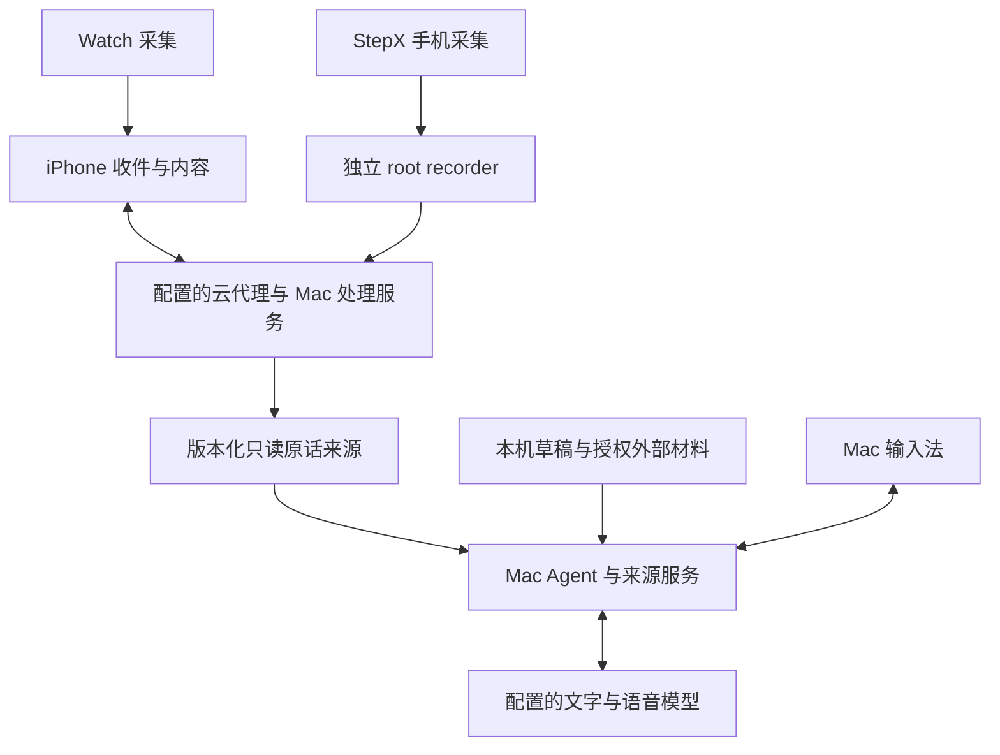

# 技术说明与当前边界

[返回首页](../README.md) · [Mac 指南](MacBook-input-method.md) · [源码范围](Source-notes.md)

## 各端职责

| 组成 | 当前代码包含什么 | 运行前提与边界 |
|---|---|---|
| Mac 输入法 | Rime 拼音、中英混输、语音、候选与依据、确认填入；草稿、整理、表达习惯、AU05 适配 | Apple Silicon、macOS 13+；AI 另需本机服务、门禁、模型和授权 |
| Mac Agent／来源服务 | 来源同步、日期与关键词检索、可选向量、生成与版本复核 | 每台 Mac 独立配置；只查询实际接通范围，不读取任意应用的完整聊天历史 |
| iPhone / Watch | Watch 持续采集、收件账本、冻结原话、语义事件、个人行动与主聊天 | 原生 iPhone 不采集录音；目标为 iOS 26 / watchOS 11，需相应 Xcode 与签名 |
| StepX client | 「此刻／行动／我」、主聊天、录音与恢复、行动、背屏、持久处理适配 | 手机直接采集；完整构建仍需 Studio SDK／容器及其平台组件 |
| StepX root recorder | 独立录音、完成片回执、授权上传、收尾递送、背屏控制 | 特定 root / Android 环境；非普通 APK 公共接口，不承诺其他机型兼容 |
| Worker 与处理服务 | ASR／模型代理、队列、来源同步和 StepX 后台协调 | 自行配置并部署，公开源码不含生产密钥，也不提供匿名服务 |

## 两条链路

这是代码职责示意，不是现有公开部署保证。iPhone 和 StepX 正式内容仍沿各自受控入口；Mac 来源副本不等于权威库迁移。另有独立文字服务承接已捕获文字和已迁草稿的受控命令，客户端增量、归属域桥和全端切换尚未完整接线。

## 录音、语义与来源

- 文件分片用于落盘、传输和处理，**不等于一件事**；完成块按账本顺序接入，同一事件可跨片延续。
- 原生 Watch 本地约 270–330 秒切块，录音期间约 15 分钟集中同步；暂停、结束、手动和启动恢复可提前补传。
- StepX root 由用户开始／停止，按选定的 5／10 分钟切片。已授权完成片和收尾事实可独立递送，后台作业推进转写、语义与 Mac 来源；App 恢复后接收本地副本和发送用户修改。
- StepX 新格式代码支持协商 16 kHz 单声道 32 kbps AAC-LC / M4A；能力缺失或编码失败回退 WAV，历史原件保留。源码不能证明设备已启用新格式。
- root 不注册开机自动录音，设备重启后需重新部署服务。12 小时是配置上限，不是已证明的连续采集、全天可靠性或电量结果。
- 删除、修订、用户确认和完成状态通过版本、事务和回执保护，不能靠重抽覆盖用户判断。回答与填入前复核来源；部分材料不能冒充完整统计。

## 声纹与外部来源

通用声纹提取、判决、注册／撤回账本、快照和兼容代码保留。发行不包含个人 seed、模板、声音、转写或标签；自动识别候选不直接进入模板库。使用者只通过自己的授权导出与「我的声音」等确认入口登记自己的材料，不能用复制他人数据库建立身份。

WithEcho、飞书和本机 Ollama 均为可选接线，各自需本人的授权或安装。声纹并非 Mac 独立输入或文字记忆的前置条件。模型路由由源码配置管理，实际模型和费用以使用者配置及服务商为准。

## 独立部署的配置边界

公开源码以 `https://apt-backend.example` 作为不可用占位地址，**不是开放服务，也不是用户可任意填写的上传目标**。独立部署需在构建前一致替换客户端 `connection.ts` 的固定 base／origin、root 上传与后台递送目标、StepX 桥 `UPSTREAM` 等源码常量及配套路由／服务绑定，再重新构建并核验各端配置一致。只改设置页地址不足以完成接线；不得接受任意 URL、动态 origin 或重定向来绕过目的地与鉴权校验。

launchd 模板中仓库路径写作 `__REPO_ROOT__`，须替换为自己的真实绝对 checkout 路径；日志路径里的 `YOUR_USER` 同理。plist 不会自动扩展 shell 占位符。声纹服务必须显式配置 `GROWTH_SV_PYTHON`，指向已安装兼容依赖的环境，不依赖维护者原机器的默认 venv。`scripts/daemons.sh` 使用 Bash，应由 Bash 执行；先核模板再安装，不能复制占位 plist 就声称服务可用。

Worker 部署脚本是已有环境的维护入口，不是首次用户一键安装。首次部署须准备自己的云资源、secret、迁移与独立验证基线；不要复制或伪造原部署回执。配置替换不改变鉴权、注册／撤回、数据写方或来源版本围栏。

## 版本与验证

本快照基线的输入法构建号为 **0.17.16 / 76**；首页截图是 **0.16.7 / 52** 的历史预览。源码、候选、安装、部署、模型实录和真机验收必须分别记录。

本说明没有新增“测试通过”或真实设备运行结论。公开导出的实际检查以新生成的验证记录为准；依赖个人素材的测试不能由本仓完整复现，也不宣称通过。新 Mac、真实键盘填入、跨应用、双 Mac 互查、全天录音和耗电仍需实测。
